<div align="center">


### Full-stack AI content platform
**Write → design → edit → review, all in one place**

[](#-license)


-5044E5?style=flat-square&logo=postgresql&logoColor=white)


**[🌐 Live App](https://ask-me-sage-kappa.vercel.app) · [⚙️ API Health](https://ask-me-backend-6i2t.onrender.com/health) · [📦 Repository](https://github.com/Oliveya-15/Ask_ME)**

</div>

<br/>

> ⏳ **The backend runs on Render's free tier.** After a period of inactivity the first request can take up to a minute while the server wakes up. That is infrastructure, not a bug.

<br/>

## 📑 Table of Contents

- [✨ What AskMe Does](#-what-askme-does)
- [📸 Screenshots](#-screenshots)
- [💎 Free vs Premium](#-free-vs-premium)
- [🧠 How Each AI Tool Works](#-how-each-ai-tool-works)
- [🔐 Authentication, Plans & Security](#-authentication-plans--security)
- [🧱 Architecture & Workflow](#-architecture--workflow)
- [🧰 Tech Stack](#-tech-stack)
- [🌍 Free Deployment Setup](#-free-deployment-setup)
- [🔗 Live Demo](#-live-demo)
- [⚡ Getting Started](#-getting-started)
- [🔧 Environment Variables](#-environment-variables)
- [🔌 API Overview](#-api-overview)
- [🗄️ Database Schema](#️-database-schema)
- [📁 Project Structure](#-project-structure)
- [🧪 Testing](#-testing)
- [🧭 Honest Limitations](#-honest-limitations)
- [🗺️ Roadmap](#️-roadmap)
- [📄 License](#-license)
- [🙏 Acknowledgments](#-acknowledgments)

<br/>

---

## ✨ What AskMe Does

<p align="center">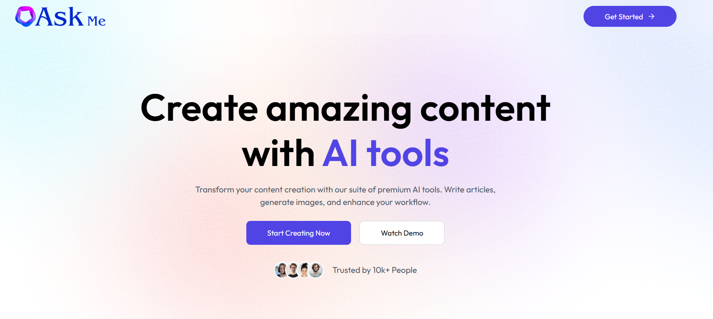</p>
<p align="center"><sub><strong>Home</strong>: landing page with every tool, pricing and sign-in</sub></p>

AskMe is a complete AI toolkit with a real backend: every tool calls a production API, results are stored per user, and access is controlled by plan.

- ✍️ **Write Article:** generate a structured Markdown article (short, medium or long) from a topic. Output has a title, section headings and a conclusion.
- #️⃣ **Blog Titles:** five catchy, SEO-friendly titles for a keyword and category.
- 🎨 **Generate Images:** text-to-image with **FLUX.1 schnell** in seven styles (Realistic, Ghibli, Anime, Cartoon, Fantasy, 3D, Portrait). Optionally publish the image to the community gallery.
- 🪄 **Remove Background:** upload a photo and get a transparent PNG back, using Cloudinary AI.
- ✂️ **Remove Object:** name one object and AI erases it from the image using Cloudinary Generative Remove.
- 📄 **Review Resume:** upload a PDF and receive a score, strengths, weaknesses, an ATS and keyword check, and concrete before/after rewrites. The PDF is read directly by Gemini, with no text-extraction step.
- 🌐 **Community:** a public gallery of published images with an atomic like button.
- 📊 **Dashboard:** your creation count, plan, and a full history of everything you generated.
- 💳 **Plans:** Free and Premium, enforced **on the server**, never trusted from the client.
- 📱 **Responsive:** the whole app works on phones.

<br/>

---

## 📸 Screenshots

<table>
<tr>
<td width="50%">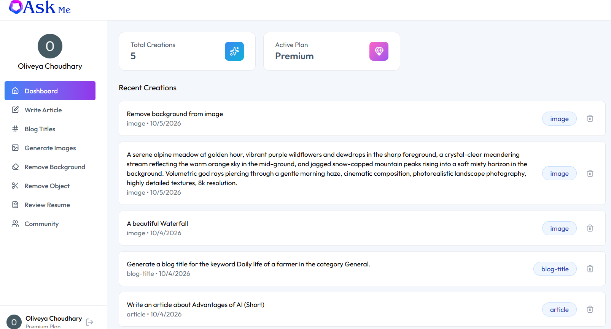<p align="center"><sub><strong>Dashboard</strong>: plan, total creations and history</sub></p></td>
<td width="50%">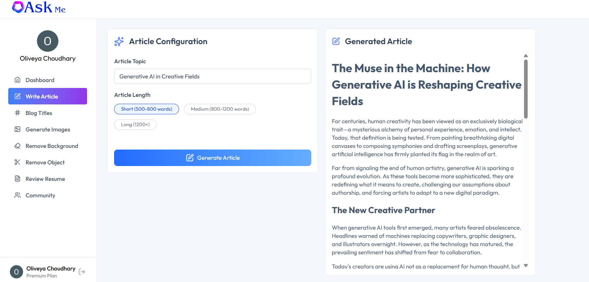<p align="center"><sub><strong>Write Article</strong>: topic, length and the generated result</sub></p></td>
</tr>
<tr>
<td width="50%">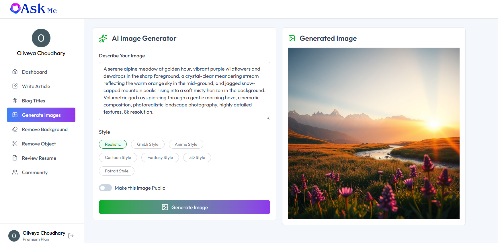<p align="center"><sub><strong>Generate Images</strong>: prompt, style and public toggle</sub></p></td>
<td width="50%">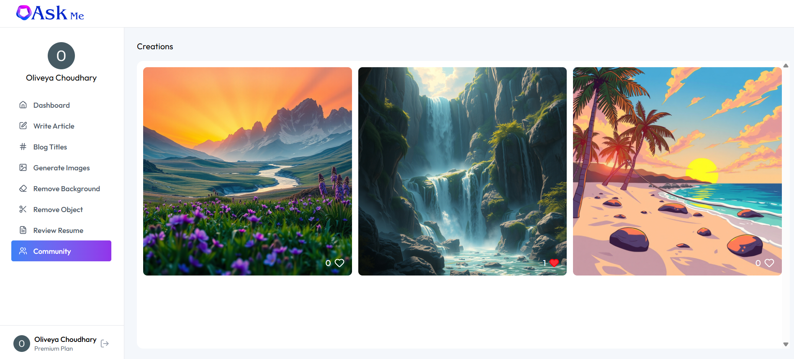<p align="center"><sub><strong>Community</strong>: published images with likes</sub></p></td>
</tr>
<tr>
<td width="50%">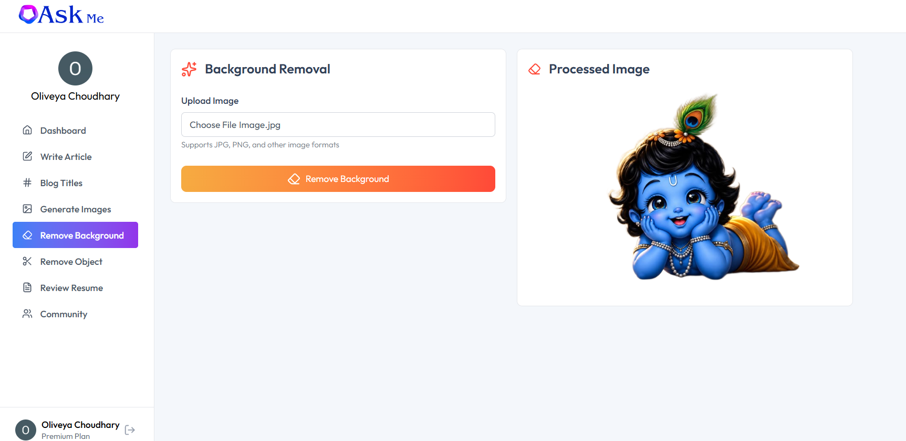<p align="center"><sub><strong>Remove Background</strong>: transparent PNG output</sub></p></td>
<td width="50%">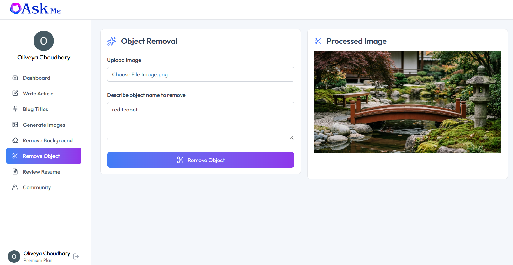<p align="center"><sub><strong>Remove Object</strong>: generative erase of a named object</sub></p></td>
</tr>
</table>

### 📄 Resume Review

<p align="center">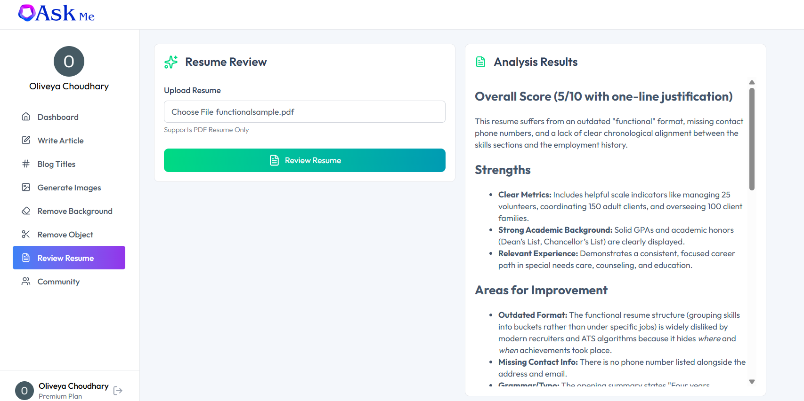</p>
<p align="center"><sub><strong>Review Resume</strong>: score, strengths, improvements, ATS check and suggested rewrites</sub></p>

### 📱 Mobile

<table align="center">
<tr>
<td align="center" width="50%">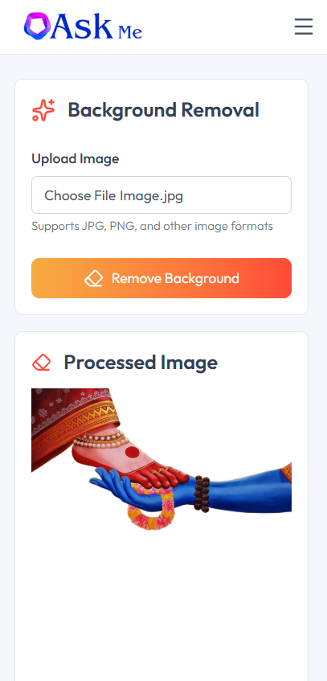<p><sub><strong>Mobile</strong>: responsive layout with slide-out navigation</sub></p></td>
</tr>
</table>

<br/>

---

## 💎 Free vs Premium

| Feature | Free | Premium |
|---|:---:|:---:|
| Write Article | ✅ (shared limit) | ✅ Unlimited |
| Blog Titles | ✅ (shared limit) | ✅ Unlimited |
| Generate Images | ❌ | ✅ |
| Remove Background | ❌ | ✅ |
| Remove Object | ❌ | ✅ |
| Review Resume | ❌ | ✅ |
| Community gallery and likes | ✅ | ✅ |
| Dashboard and history | ✅ | ✅ |

- The Free limit is **10 generations in total** across articles and blog titles. It is configurable with `FREE_USAGE_LIMIT`.
- Premium is a **Clerk Billing** plan with the slug `premium`. A user can also be granted Premium manually with `{ "plan": "premium" }` in their Clerk public metadata, which is how I test locally without payments.
- The Premium plan runs on a Clerk **development** instance, so checkout uses test payments and no real money is charged.

<br/>

---

## 🧠 How Each AI Tool Works

| Tool | Input | Engine | Output |
|---|---|---|---|
| **Write Article** | topic + length (800 / 1200 / 1600 words) | Google **Gemini** Flash | Markdown article |
| **Blog Titles** | keyword + category | Google **Gemini** Flash | Numbered list of 5 titles |
| **Generate Images** | prompt + style + publish flag | **Cloudflare Workers AI** (FLUX.1 schnell) → stored on **Cloudinary** | Image URL |
| **Remove Background** | JPG / PNG / WEBP / GIF, up to 8 MB | **Cloudinary** `background_removal` | Transparent PNG URL |
| **Remove Object** | image + one object name | **Cloudinary** `gen_remove` | Edited image URL |
| **Review Resume** | PDF, up to 5 MB | **Gemini** with native PDF input | Structured Markdown review |

### Text generation (Gemini)

- **Prompts live in one file** (`server/src/services/prompts.js`) so wording is easy to review and tune.
- **Prompt-injection hygiene:** user text is wrapped in `<topic>` / `<keyword>` tags and the system instruction tells the model to treat it strictly as data.
- **Automatic fallback:** if the primary model (`gemini-flash-latest`) is rate-limited or unavailable, the request is retried on a lighter model (`gemini-flash-lite-latest`). Model names are environment variables, so a retired model never requires a code change.
- **Safety-aware errors:** blocked prompts, rate limits and outages are mapped to clear messages without leaking provider internals.

### Image generation (Cloudflare + Cloudinary)

1. The selected style is appended to the user's prompt (for example, "Ghibli Style" adds a hand-painted animation description).
2. Cloudflare returns the image as base64.
3. The image is uploaded to Cloudinary and only the **secure URL** is saved in the database, never the image itself.

### Background and object removal (Cloudinary AI)

- The upload is validated, sent to Cloudinary from memory (no temp files), and a delivery URL with the AI effect is built.
- Cloudinary computes AI effects on first request and can answer "still processing", so the server **polls until the result is ready** and the browser never receives a half-ready URL.
- The object name is restricted to letters, numbers, spaces and hyphens, because it is placed inside a Cloudinary effect string where other characters have special meaning.

<br/>

---

## 🔐 Authentication, Plans & Security

| Area | Implementation |
|---|---|
| **Authentication** | **Clerk** handles sign-up, sign-in and sessions. The API verifies the Clerk JWT on every protected route. |
| **Plan enforcement** | Server-side middleware checks the `premium` plan (Clerk Billing) with a `publicMetadata` fallback, cached for 60 seconds. Free users are counted from the database. |
| **Rate limiting** | 300 requests per 15 minutes per IP across the API, plus **6 AI requests per minute per user** to protect shared free-tier quotas. |
| **Uploads** | In-memory only. Size caps, a MIME filter **and** magic-byte verification, so a renamed executable is rejected. |
| **Input validation** | Every request body is validated with **zod** (types, lengths, allowed enums). |
| **HTTP hardening** | `helmet` security headers, a strict CORS allow-list, a 100 KB JSON body limit and a hidden `X-Powered-By`. |
| **Database safety** | Parameterized SQL everywhere. Likes use a single atomic `UPDATE`, so simultaneous likes can never overwrite each other. |
| **Secrets** | Environment variables only, validated at startup. The server **refuses to start** if one is missing instead of failing on the first user request. |
| **Data isolation** | Creations belong to the signed-in account and are visible only to that user. Only images explicitly published appear in the community. |

<br/>

---

## 🧱 Architecture & Workflow

<p align="center">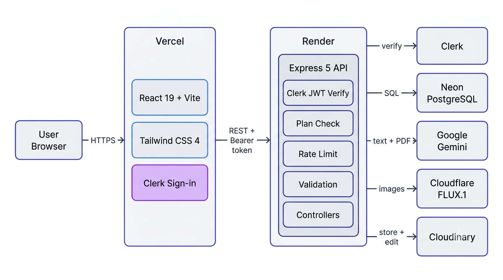</p>

<p align="center">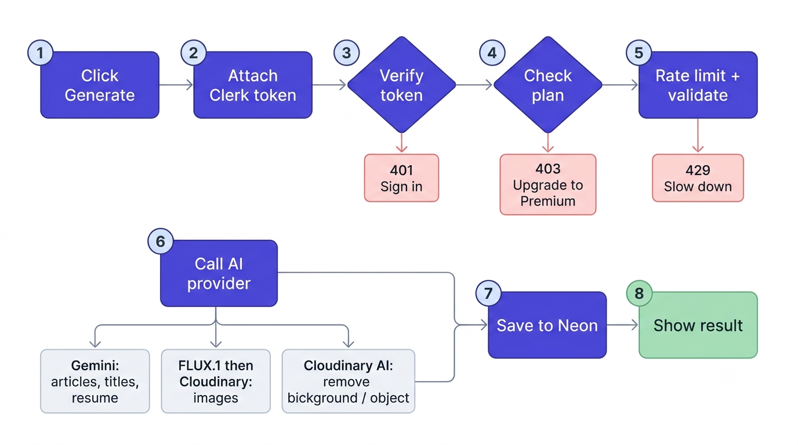</p>

AskMe is a **layered monolith**: one API process, one database and one frontend build, with every concern in its own folder so any part can be read, tested or replaced on its own.

| Layer | Responsibility |
|---|---|
| `routes/` | Wires URLs to middleware and controllers |
| `middleware/` | Authentication, plan gating, rate limiting, uploads, centralized error handling |
| `controllers/` | Thin request handlers: validate, call services, save, respond |
| `validators/` | zod schemas for every request body |
| `services/` | Third-party integrations (Gemini, Cloudflare, Cloudinary) and prompt construction |
| `db/` | Connection pool, idempotent schema migration and the repository |
| `config/` | Environment validation (fail-fast) |
| `client/src/` | React pages, shared components, an authenticated API hook and plan hook |

**Design principles:**

- **The server is the source of truth.** Plans, limits and ownership are enforced on the backend, never in the UI.
- **Graceful degradation.** Provider failures become friendly, specific messages. Gemini has a fallback model. Every external call has a timeout.
- **Free-tier realism.** Pooled connections, in-memory uploads and lightweight dependencies fit comfortably within free hosting limits.
- **Auto-migration.** The schema is created on first boot, so deployment needs no manual SQL.

<br/>

---

## 🧰 Tech Stack

<table>
<tr><th>Layer</th><th>Technology</th><th>Why</th></tr>
<tr><td>Frontend</td><td>React 19 · Vite · React Router · Tailwind CSS 4 · Axios · react-markdown · react-hot-toast · Lucide icons</td><td>Fast SPA deployed on a global CDN</td></tr>
<tr><td>Backend</td><td>Node.js 22 · Express 5 · zod · multer · helmet · express-rate-limit · morgan</td><td>AI requests can run 10 to 60 seconds, which suits a long-running server better than short serverless limits</td></tr>
<tr><td>Database</td><td>PostgreSQL on Neon (<code>pg</code> pool)</td><td>Relational data, constraints, indexes and atomic updates, with a serverless free tier</td></tr>
<tr><td>Auth & Plans</td><td>Clerk (<code>@clerk/react</code>, <code>@clerk/express</code>) + Clerk Billing</td><td>Hosted, secure authentication plus a pricing table and plan checks</td></tr>
<tr><td>Text AI</td><td>Google Gemini API (Flash, with fallback model)</td><td>Free tier, fast, and accepts PDFs natively</td></tr>
<tr><td>Image generation</td><td>Cloudflare Workers AI (FLUX.1 schnell)</td><td>Daily free allowance through a simple REST call</td></tr>
<tr><td>Image storage & editing</td><td>Cloudinary</td><td>CDN storage plus AI background removal and generative remove</td></tr>
<tr><td>Testing</td><td>Node's built-in test runner (<code>node:test</code>), 12 tests</td><td>No extra test framework to install</td></tr>
<tr><td>Deployment</td><td>Vercel (frontend) · Render (backend) · Neon (database)</td><td>All free tiers</td></tr>
</table>

**No paid service is required anywhere in this stack.** Hosting, database, authentication, text AI, image AI and media storage all run on free tiers.

<br/>

---

## 🌍 Free Deployment Setup

| Part | Host | Why |
|---|---|---|
| Frontend | **Vercel** | Free static hosting, auto-deploys from GitHub, SPA rewrites in `client/vercel.json` |
| Backend | **Render** (free web service) | Runs the Express API from the `server` folder, defined in `render.yaml` |
| Database | **Neon** (free PostgreSQL) | Serverless Postgres that scales to zero when idle |
| Auth | **Clerk** | Free tier covers a portfolio comfortably |
| Text AI | **Google Gemini API** | Free tier for Flash models |
| Image AI | **Cloudflare Workers AI** | Free daily neuron allowance |
| Media | **Cloudinary** | Free monthly credits |

**Key engineering decisions:**

- **Split hosting.** The static SPA lives on a CDN (Vercel) and the long-running API on Render. CORS is locked to the Vercel origin.
- **Two health endpoints.** `/health` is a cheap liveness probe that does **not** touch the database, so an uptime monitor can keep Render awake without waking Neon. `/health/ready` also checks the database connection.
- **Fail-fast configuration.** Missing or invalid environment variables stop the server at boot with a precise message.
- **Graceful shutdown.** The server handles `SIGTERM` so Render redeploys close connections cleanly.

**Deploy it yourself:** the complete step-by-step guide, including account setup for every service, is in [`AskMe_Setup_Guide.docx`](AskMe_Setup_Guide.docx). A one-click Render blueprint is included as [`render.yaml`](render.yaml).

<br/>

---

## 🔗 Live Demo

| | |
|---|---|
| 🌐 **App** | [ask-me-sage-kappa.vercel.app](https://ask-me-sage-kappa.vercel.app) |
| ⚙️ **API health** | [ask-me-backend-6i2t.onrender.com/health](https://ask-me-backend-6i2t.onrender.com/health) |
| 📦 **Source** | [github.com/Oliveya-15/Ask_ME](https://github.com/Oliveya-15/Ask_ME) |

> 🔑 Create a free account to explore. Please avoid uploading real, sensitive documents: the Gemini free tier may use submitted content to improve Google products, so use a sample resume for the demo.

<br/>

---

## ⚡ Getting Started

**Requirements:** Node.js 20+ (22 recommended), Git, and free accounts for Neon, Clerk, Google AI Studio, Cloudflare and Cloudinary. The detailed account setup is in the [setup guide](AskMe_Setup_Guide.docx).

### 1. Clone

```bash
git clone https://github.com/Oliveya-15/Ask_ME.git
cd Ask_ME
```

### 2. Start the API

```bash
cd server
cp .env.example .env        # Windows: copy .env.example .env
# fill in the values (see "Environment Variables" below)
npm install
npm run dev                 # http://localhost:3000/health
```

You should see `[db] schema ready` followed by `AskMe API listening on :3000`. Tables are created automatically.

### 3. Start the frontend

Open a second terminal:

```bash
cd client
cp .env.example .env        # Windows: copy .env.example .env
npm install
npm run dev                 # http://localhost:5173
```

### 4. Unlock Premium locally

Sign in once, then in the Clerk dashboard open **Users → your user → Public metadata** and save:

```json
{ "plan": "premium" }
```

Refresh the app. The Sidebar shows **Premium** and every tool unlocks.

<br/>

---

## 🔧 Environment Variables

### Server (`server/.env`)

| Variable | Required | Description |
|---|:---:|---|
| `NODE_ENV` | | `development` or `production` |
| `PORT` | | API port (default `3000`) |
| `CLIENT_URL` | ✅ | Allowed frontend origin(s), comma-separated, **no trailing slash** |
| `DATABASE_URL` | ✅ | Neon connection string (use the pooled one) |
| `CLERK_PUBLISHABLE_KEY` | ✅ | Clerk publishable key (`pk_...`) |
| `CLERK_SECRET_KEY` | ✅ | Clerk secret key (`sk_...`), must be from the same Clerk app |
| `GEMINI_API_KEY` | ✅ | Google AI Studio API key |
| `GEMINI_MODEL` | | Primary model (default `gemini-flash-latest`) |
| `GEMINI_FALLBACK_MODEL` | | Fallback model (default `gemini-flash-lite-latest`) |
| `CLOUDFLARE_ACCOUNT_ID` | ✅ | Cloudflare account ID |
| `CLOUDFLARE_API_TOKEN` | ✅ | Workers AI API token |
| `CLOUDFLARE_IMAGE_MODEL` | | Default `@cf/black-forest-labs/flux-1-schnell` |
| `CLOUDINARY_CLOUD_NAME` | ✅ | From a **Programmable Media** account (not Media Optimizer) |
| `CLOUDINARY_API_KEY` | ✅ | Cloudinary API key |
| `CLOUDINARY_API_SECRET` | ✅ | Cloudinary API secret |
| `FREE_USAGE_LIMIT` | | Free-plan generations (default `10`) |

### Client (`client/.env`)

| Variable | Description |
|---|---|
| `VITE_CLERK_PUBLISHABLE_KEY` | Clerk publishable key |
| `VITE_BASE_URL` | API URL, for example `http://localhost:3000` (no trailing slash). Baked in at build time, so **redeploy after changing it**. |

> 🔒 `.env` files are git-ignored. Only the `.env.example` templates, which contain fake values, are committed.

<br/>

---

## 🔌 API Overview

All `/api` routes require `Authorization: Bearer <Clerk session token>`. Successful responses are `{ "success": true, ... }`. Errors are `{ "success": false, "message": "..." }` with a meaningful HTTP status (`400` validation, `401` not signed in, `403` plan or limit, `413` file too large, `415` bad file type, `429` rate limited, `502/503/504` upstream problems).

| Method | Endpoint | Access | Body |
|---|---|---|---|
| `GET` | `/health` | public | Liveness probe (no database) |
| `GET` | `/health/ready` | public | Readiness probe (checks database) |
| `GET` | `/api/user/creations` | signed in | The user's history |
| `GET` | `/api/user/published-creations` | signed in | Public community images |
| `POST` | `/api/user/toggle-like-creation` | signed in | `{ id }` |
| `POST` | `/api/ai/generate-article` | Free (limited) / Premium | `{ topic, length }` |
| `POST` | `/api/ai/generate-blog-title` | Free (limited) / Premium | `{ keyword, category }` |
| `POST` | `/api/ai/generate-image` | Premium | `{ prompt, style, publish }` |
| `POST` | `/api/ai/remove-image-background` | Premium | multipart: `image` |
| `POST` | `/api/ai/remove-image-object` | Premium | multipart: `image`, `object` |
| `POST` | `/api/ai/resume-review` | Premium | multipart: `resume` (PDF) |

<br/>

---

## 🗄️ Database Schema

One table, created automatically and idempotently on boot (`server/src/db/schema.sql`).

| Column | Type | Notes |
|---|---|---|
| `id` | `INTEGER` identity | Primary key |
| `user_id` | `TEXT` | Clerk user ID |
| `prompt` | `TEXT` | What the user asked for |
| `content` | `TEXT` | Markdown text, or an image URL |
| `type` | `TEXT` | `CHECK` constraint: `article`, `blog-title`, `image`, `resume-review` |
| `publish` | `BOOLEAN` | `true` shows the image in the community |
| `likes` | `TEXT[]` | Clerk IDs of users who liked it |
| `created_at` / `updated_at` | `TIMESTAMPTZ` | Timestamps |

Indexes: `(user_id, created_at DESC)` for the dashboard, and a **partial index** on published rows for the community feed.

<br/>

---

## 📁 Project Structure

```
Ask_ME/
├── client/                      React frontend (Vercel)
│   ├── src/
│   │   ├── components/          Navbar, Hero, Sidebar, AiTools, Plan, ...
│   │   ├── pages/               Dashboard, WriteArticle, BlogTitles, Generateimages,
│   │   │                        Removebackground, Removeobject, ReviewResume, Community
│   │   ├── hooks/               useApi (authenticated client), useIsPremium
│   │   └── lib/api.js           Axios instance + error helper
│   ├── vercel.json              SPA rewrites
│   └── .env.example
├── server/                      Express API (Render)
│   ├── src/
│   │   ├── config/env.js        Validated environment (fail-fast)
│   │   ├── db/                  pool, schema.sql, migrate, creations repository
│   │   ├── middleware/          auth + plan gating, rateLimit, upload, errorHandler
│   │   ├── services/            gemini, cloudflare, cloudinary, prompts
│   │   ├── validators/          zod request schemas
│   │   ├── controllers/         ai, user
│   │   ├── routes/              ai, user
│   │   ├── app.js               Express app (CORS, helmet, routes)
│   │   └── server.js            Boot, migration, graceful shutdown
│   ├── test/api.test.js         12 automated tests
│   └── .env.example
├── public/                      README images
├── render.yaml                  Render blueprint
├── AskMe_Setup_Guide.docx       Full setup and deployment guide
└── README.md
```

<br/>

---

## 🧪 Testing

```bash
cd server
npm test
```

**12 automated tests** run without any real credentials and cover:

- Health endpoint works without auth or database
- Every protected route rejects anonymous requests
- Unknown routes return a JSON 404
- CORS accepts the allowed origin and rejects others
- Security headers are set and `X-Powered-By` is hidden
- File-signature (magic byte) validation for PDFs and images
- Prompt builders keep user input delimited
- Request validators, including attempts to inject characters into the Cloudinary effect string

<br/>

---

## 🧭 Honest Limitations

- **Cold starts.** Render's free tier sleeps after about 15 minutes idle, so the first request can take around a minute. An external uptime monitor pinging `/health` every 5 minutes removes most of this.
- **Free-tier quotas.** Gemini has per-minute limits, Cloudflare gives a daily image allowance and Cloudinary a monthly credit pool. When one is exhausted the app shows a clear message instead of failing silently.
- **AI output quality.** Articles and reviews are generated text and can contain mistakes. FLUX.1 schnell prioritizes speed over maximum detail.
- **Demo billing.** Premium runs on a Clerk development instance with test payments, and the UI shows a "Development mode" label.
- **Privacy.** The Gemini free tier may use submitted content to improve Google products. Originals uploaded for background or object removal stay in the Cloudinary media library until deleted.
- **In-memory rate limiting.** Limits are per server instance. Running multiple instances would need a shared store such as Redis.
- **Likes as an array.** Perfect at this scale and atomic, but a join table would suit very large scale.
- **Test scope.** Tests cover the API surface that needs no credentials. SQL integration tests and mocked-provider controller tests are not included yet.

<br/>

---

## 🗺️ Roadmap

- [ ] Stream article text to the UI as it is generated
- [ ] Delete and re-run past creations from the dashboard
- [ ] Pagination for the dashboard and community feed
- [ ] Download button for generated and edited images
- [ ] Redis-backed rate limiting for multi-instance deployments
- [ ] Integration tests against a real PostgreSQL and mocked AI providers
- [ ] Structured logging and error monitoring
- [ ] Optional prompt history and templates

<br/>

---

## 📄 License

Released under the **MIT License**. See the `LICENSE` file for details.

<br/>

---

## 🙏 Acknowledgments

- [Clerk](https://clerk.com), [Neon](https://neon.tech), [Render](https://render.com) and [Vercel](https://vercel.com) for generous free tiers
- [Google Gemini](https://ai.google.dev), [Cloudflare Workers AI](https://developers.cloudflare.com/workers-ai/) and [Cloudinary](https://cloudinary.com) for the AI and media services
- [Black Forest Labs](https://bfl.ai) for the FLUX.1 model
- [Lucide](https://lucide.dev) for the icon set and [Tailwind CSS](https://tailwindcss.com) for styling

<br/>

<div align="center">

**Designed, built and deployed end to end on free-tier infrastructure.**

<sub>AskMe · AI Content Platform · 2026</sub>

</div>
